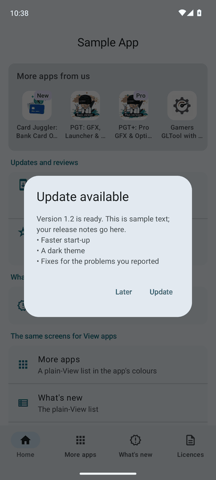
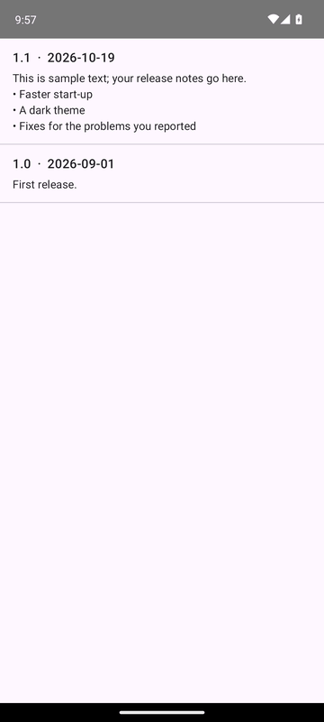
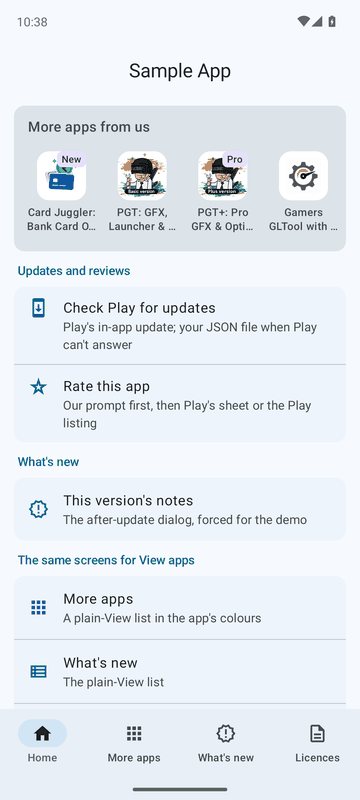
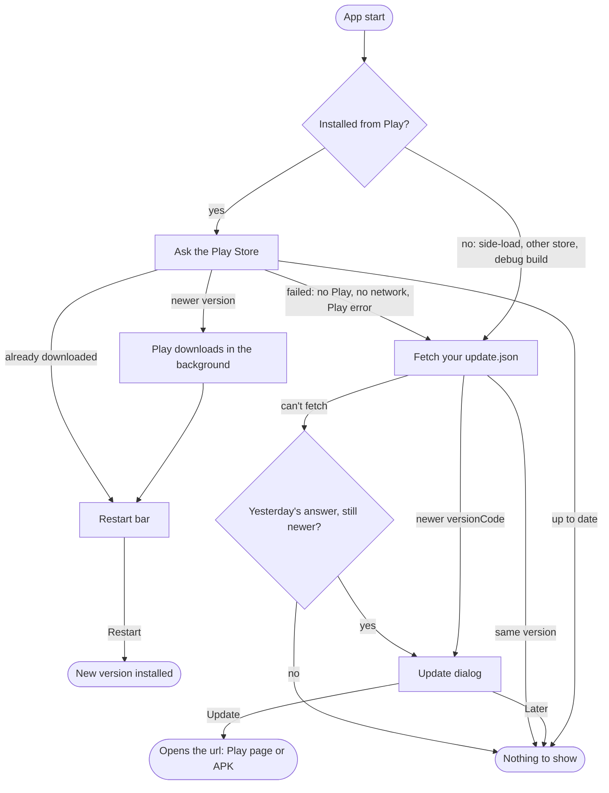
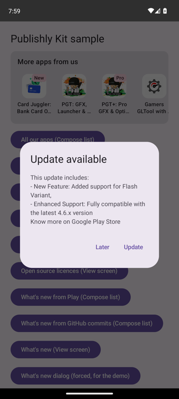
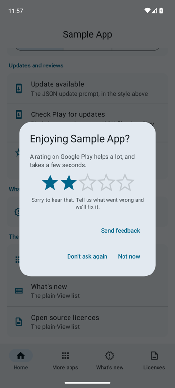
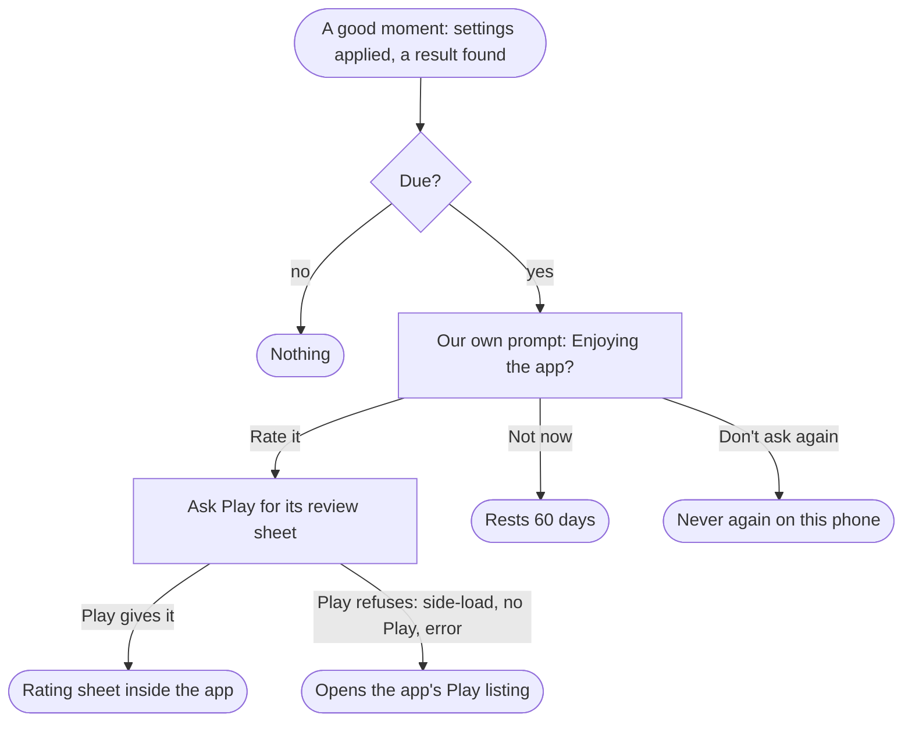
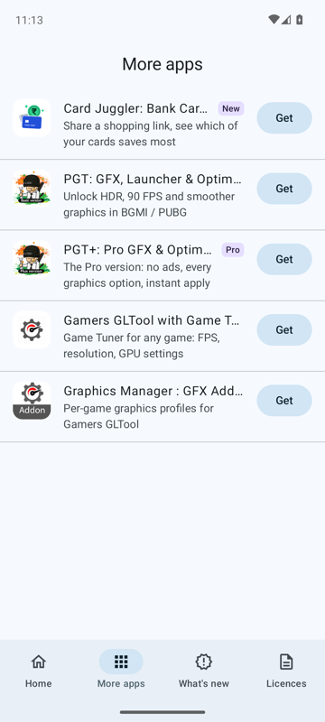
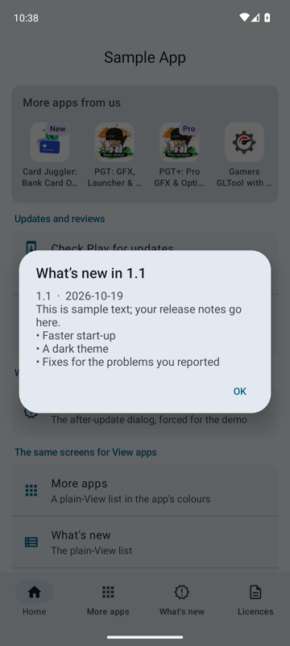
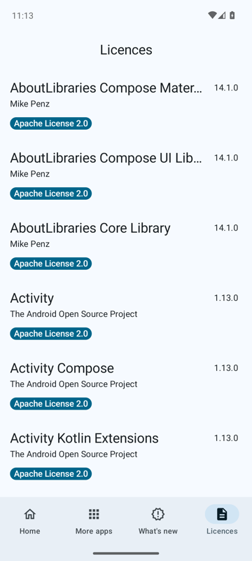

# Publishly Kit

The things every one of my Android apps needs, in one small library: in-app updates, an in-app review prompt with a rule for when to ask, a "More apps from us" promo fed from a JSON file, a "What's new" screen, an open source licence list, and one theme so all of it looks like the app it lives in. Plain Kotlin at the core, so it fits old View/Java apps, plus a Compose module for new ones.

<table>
<tr>
<td align="center"><br><sub>Update dialog, More apps, review prompt, What's new, licences</sub></td>
<td align="center"><br><sub>What's new: Play listing, GitHub commits, View screen, dialog</sub></td>
<td align="center"><br><sub>Material You, light and dark, Compose and View screens alike</sub></td>
</tr>
</table>

Recorded from the sample app on an API 33 emulator. Stills of every screen are in [docs/screenshots](docs/screenshots).

| Module | What's in it |
| --- | --- |
| `kit` | `Updates` (`PlayUpdates` + `JsonUpdates`), `AppReview`, `ReviewAsk`, `AppPromos`, `WhatsNew`, `OpenSource`, `KitTheme`, with plain-View screens and dialogs for each. No Compose dependency. |
| `kit-compose` | `SyncKitTheme()`, `UpdateFlow()`, `UpdateReadyBar()`, `UpdateDialog()`, `ReviewPromptDialog()`, `MoreAppsRow()`, `MoreAppsList()`, `FeaturedPromoDialog()`, `WhatsNewList()`, `WhatsNewDialog()`, `OpenSourceScreen()`. Depends on `kit`. |
| `sample` | One screen that uses everything, with the template promo feed. |

Kotlin, minSdk 24, built with AGP 9.0.1 / compileSdk 36.

## Contents

1. [Add it](#1-add-it)
2. [Quick start: a Compose app](#2-quick-start-a-compose-app)
3. [Quick start: a View app](#3-quick-start-a-view-app)
4. [In-app updates](#4-in-app-updates)
5. [In-app review](#5-in-app-review)
6. [Your own apps' promo](#6-your-own-apps-promo-apppromos)
7. [What's new](#7-whats-new-whatsnew)
8. [Open source licences](#8-open-source-licences)
9. [Theme](#9-theme-one-look-for-every-element-kittheme), [customising each element](#customise-each-element)
10. [Before you ship](#10-before-you-ship)
11. [The sample app](#11-the-sample-app)
12. [Build and test](#12-build-and-test)

## 1. Add it

Through [JitPack](https://jitpack.io). In `settings.gradle.kts`:

```kotlin
dependencyResolutionManagement {
    repositories {
        google()
        mavenCentral()
        maven("https://jitpack.io")
    }
}
```

In the app module (replace `<tag>` with a release tag such as `v1.0.0`):

```kotlin
dependencies {
    implementation("com.github.Trilokia.publishly-android:kit:<tag>")
    implementation("com.github.Trilokia.publishly-android:kit-compose:<tag>")   // Compose apps only
}
```

Working on the library itself: `./gradlew publishToMavenLocal`, then `mavenLocal()` in the repositories and `inc.trilokia:kit:1.0.0` / `inc.trilokia:kit-compose:1.0.0`.

The library declares the `INTERNET` permission and a `<queries>` block for launcher apps (so it can see which of your apps are installed). Nothing else to add to the manifest.

## 2. Quick start: a Compose app

Everything wired into one activity. Each piece is optional; delete what you don't need.

```kotlin
class MainActivity : ComponentActivity() {
    private lateinit var updates: Updates

    override fun onCreate(savedInstanceState: Bundle?) {
        super.onCreate(savedInstanceState)

        // Updates: Play first, your JSON file when Play can't answer (side-loads, other stores,
        // no Play). Build it here: it registers an activity-result launcher
        updates = Updates(this, jsonUrl = "https://www.example.com/update.json")
        // Your other apps, from a JSON feed on your server
        val promos = AppPromos(this, url = "https://www.example.com/apps.json")
        // "What's new", from this app's Play listing
        val whatsNew = WhatsNew(this, WhatsNewSource.Play(packageName))
        // Ask for a review after 3 good moments, not in the first 2 days, at most once per 60 days
        val reviewAsk = ReviewAsk(this)

        setContent {
            MaterialTheme(colorScheme = if (isSystemInDarkTheme()) darkColorScheme() else lightColorScheme()) {
                SyncKitTheme()   // the View screens and dialogs take these colours too

                // Dialogs, in turn: the update flow first, then the featured app, then what's new
                var updatesSettled by remember { mutableStateOf(false) }
                UpdateFlow(updates) { updatesSettled = true }
                if (updatesSettled) FeaturedPromoDialog(promos)
                WhatsNewDialog(whatsNew)

                Scaffold(bottomBar = { UpdateReadyBar(updates) }) { padding ->
                    Column(Modifier.padding(padding)) {
                        MoreAppsRow(promos)                      // draws nothing when there is nothing to show
                        Button(onClick = {
                            doTheThingYourAppIsFor()
                            reviewAsk.recordEvent()              // a good moment
                            reviewAsk.askIfDue(this@MainActivity)
                        }) { Text("Do the thing") }
                        // Settings rows: WhatsNewList(whatsNew), MoreAppsList(promos), OpenSourceScreen()
                    }
                }
            }
        }
    }
}
```

## 3. Quick start: a View app

The same features without Compose. Every screen has a plain-View version that takes the app's colours (see [Theme](#9-theme-one-look-for-every-element-kittheme)).

```kotlin
class MainActivity : AppCompatActivity() {   // ComponentActivity or AppCompatActivity, for Play updates
    private lateinit var updates: Updates

    override fun onCreate(savedInstanceState: Bundle?) {
        super.onCreate(savedInstanceState)
        setContentView(R.layout.activity_main)

        updates = Updates(this, jsonUrl = "https://www.example.com/update.json")
        lifecycleScope.launch {
            updates.downloaded.collect { if (it) showRestartSnackbar { updates.complete() } }
        }

        val promos = AppPromos(this, url = "https://www.example.com/apps.json")
        val whatsNew = WhatsNew(this, WhatsNewSource.Play(packageName))
        val reviewAsk = ReviewAsk(this)

        lifecycleScope.launch {
            val outcome = updates.check()
            if (outcome is Updates.Outcome.JsonUpdate) {
                updates.showDialog(this@MainActivity, outcome.info)
            } else {
                promos.featured()?.let { promos.showFeaturedDialog(this@MainActivity, it) }
                whatsNew.showDialog(this@MainActivity, whatsNew.pending())
            }
        }

        findViewById<View>(R.id.more_apps).setOnClickListener { promos.openList(this) }
        findViewById<View>(R.id.whats_new).setOnClickListener { whatsNew.openList(this) }
        findViewById<View>(R.id.licences).setOnClickListener { OpenSource.open(this) }
        findViewById<View>(R.id.do_the_thing).setOnClickListener {
            doTheThingYourAppIsFor()
            reviewAsk.recordEvent()
            reviewAsk.askIfDue(this)
        }
    }
}
```

Java apps can call the same classes; the `suspend` functions (`check()`, `featured()`, `pending()`, `notes()`) need a coroutine, for example `BuildersKt.runBlocking` on a background thread, or a small Kotlin helper.

## 4. In-app updates

Two sources, one flow. Play's in-app update is the smooth one (background download, the user never leaves the app), so it goes first wherever it can work. It can't work for side-loads, other stores, debug builds or phones without Play, and it fails whenever Play has a bad day; all of those fall back to a small JSON file on your server. `Updates` runs the whole thing:



```kotlin
updates = Updates(this, jsonUrl = "https://www.example.com/update.json")   // in onCreate; jsonUrl may be null
// bundledJson = assets.open("update.json")...: a copy shipped in the app, used until the server has answered once

// Compose: the dialog when the JSON file has news, nothing otherwise; onSettled queues the next dialog
UpdateFlow(updates) { /* settled */ }
Scaffold(bottomBar = { UpdateReadyBar(updates) }) { ... }

// View: one suspend call tells you what happened
lifecycleScope.launch {
    when (val outcome = updates.check()) {
        is Updates.Outcome.JsonUpdate -> updates.showDialog(this@MainActivity, outcome.info)
        else -> { }   // PlayDownloading, PlayDownloaded, UpToDate, Nothing: Play handles its own
    }
}
```

One deliberate rule: when Play answers "up to date", the JSON file is **not** consulted, even if it names a newer version. A staged rollout may not have reached this phone yet, and a dialog sending the user to a Play page that still shows the old version would be a dead end. `updates.play` and `updates.json` are the two halves, for the details below.



### Through Play (`PlayUpdates`)

Play's own in-app update flow: the new version downloads in the background and the app asks for a restart.

```kotlin
val playUpdates = updates.play     // or PlayUpdates(this) on its own, in onCreate
playUpdates.checkQuietly()         // flexible flow: downloads when Play has a newer version
```

- `playUpdates.downloaded` is a `StateFlow<Boolean>`; it turns true when the download lands. Show "Restart" and call `playUpdates.complete()`. Compose apps drop `UpdateReadyBar(playUpdates)` into the layout and get both.
- For a "Check for updates" row in Settings, `playUpdates.checkNow { result -> }` reports `UP_TO_DATE`, `FLOW_STARTED`, `DOWNLOADED` or `FAILED`.

Play updates only work for apps installed from Play, and only once a higher versionCode is live on a track your test account is on. On an emulator or a side-loaded build, `checkNow` reports `FAILED`.

### Through your own JSON file (`JsonUpdates`)

The check the PGT apps have used for years: a small file on your server says which version is the latest. It works without Play, and it lets you push a message to old versions at any time. Host a file like this (`releaseNotes` may also be one string):

```json
{
  "latestVersion": "0.21.7",
  "latestVersionCode": "193",
  "url": "https://play.google.com/store/apps/details?id=inc.trilokia.pubgfxtool.free",
  "releaseNotes": ["This update includes:", "- New feature ..."]
}
```

```kotlin
val jsonUpdates = updates.json!!   // or JsonUpdates(this, "https://www.example.com/update.json") on its own
lifecycleScope.launch {
    jsonUpdates.check()?.let { info -> jsonUpdates.showDialog(this@MainActivity, info) }
}
```

`check()` returns the newer version or null. The last server answer is kept, so an offline phone still sees the dialog it saw yesterday. Compose apps show `UpdateDialog(info, onDismiss)` instead of `showDialog`. Pass `cancelable = false` to either for a forced update.

<br clear="right">

## 5. In-app review



Play's rating sheet is the goal, but it has two catches: Play shows it only a few times per user and never says whether it did, and it needs the app to come from Play. So the flow asks **you** first, then Play, and falls back to the Play listing:



"Due" is the rule that rations the asks, so Play is only bothered for people who just said yes:

| Rule | Default | Constructor parameter |
| --- | --- | --- |
| Good moments before the first ask | 3 | `minEvents` |
| Days after install before the first ask | 2 | `minAgeMs` |
| Days between asks | 60 | `restMs` |
| Asks per phone, ever | 4 | `maxAsks` |

```kotlin
val reviewAsk = ReviewAsk(context)

// Compose: the prompt lives in the composition and shows itself when asked
ReviewPromptDialog(reviewAsk)
// ...after the app has just been useful (settings applied, a result found, a file saved...)
reviewAsk.recordEvent()
reviewAsk.requestIfDue()

// View: the same prompt as a plain dialog in the Kit theme
reviewAsk.recordEvent()
reviewAsk.askIfDue(activity)   // true when it asked
```

`reviewAsk.requestPrompt()` raises the prompt regardless of the rule, for a "Rate this app" row in Settings. The halves on their own: `AppReview.askOrOpenStore(activity)` (Play's sheet, or the listing), `AppReview.ask(activity)` (just the sheet), `AppReview.openStore(context)` (just the listing). `reviewAsk.stop()` ends the asks on this phone for good. The one case nobody can detect: Play accepting the request and then quietly skipping the sheet; the fallback covers Play refusing outright.

<br clear="right">

## 6. Your own apps' promo (`AppPromos`)



Cross-promotion without an ad network: a JSON file on your server lists your apps, and every app shows the ones the phone doesn't have yet. Edit the file, and all apps pick it up within a day. [promo/apps.json](promo/apps.json) is the template; upload it as, say, `https://www.example.com/apps.json`:

```json
{
  "apps": [
    { "package": "inc.trilokia.cardjuggler", "name": "Card Juggler: Bank Card Offers",
      "tagline": "Share a shopping link, see which of your cards saves most",
      "icon": "https://play-lh.googleusercontent.com/...=s256", "badge": "New", "priority": 100 }
  ],
  "featured": { "package": "inc.trilokia.cardjuggler", "title": "New from Trilokia: Card Juggler", "message": "..." }
}
```

Only `package` and `name` are required. `url` sends "Get" somewhere other than the Play page. The Play link carries the promoting app's package as the install referrer, so Play Console shows which app brought each install.

```kotlin
val promos = AppPromos(
    context,
    url = "https://www.example.com/apps.json",
    bundledJson = assets.open("apps.json").bufferedReader().readText(),   // optional: used until the server answers
)
```

Compose apps:

```kotlin
MoreAppsRow(promos)          // a card with a scrolling row of icons; draws nothing when there's nothing to show
MoreAppsList(promos)         // the full list with taglines and "Get" buttons, on its own screen
FeaturedPromoDialog(promos)  // the featured app, in a dialog, when it's due (not installed, once a week, until dismissed)
```

View apps:

```kotlin
promos.openList(activity)                                   // the list screen
lifecycleScope.launch {
    promos.featured()?.let { promos.showFeaturedDialog(activity, it) }
}
```

`promos.apps()` gives the filtered list for your own UI, `PromoIcons.load(context, url)` the icons (cached on disk). The featured dialog rests 7 days between showings (`featuredRestMs`), and "Not now" ends it for that app on that phone.

<br clear="right">

## 7. What's new (`WhatsNew`)



A "What's new" screen, and a dialog that shows this version's notes once after an update. Pick where the text comes from:

```kotlin
WhatsNew(context, WhatsNewSource.Play(packageName))                               // the Play listing's "What's new" box
WhatsNew(context, WhatsNewSource.Json("https://www.example.com/release-notes.json"))
WhatsNew(context, WhatsNewSource.Bundled(assets.open("release-notes.json").bufferedReader().readText()))   // shipped in the app
WhatsNew(context, WhatsNewSource.GitHubReleases("Trilokia", "pgt"))               // tag + body of each release
WhatsNew(context, WhatsNewSource.GitHubCommits("Trilokia", "pgt", branch = "main"))  // one line per commit
```

- **Play** needs nothing hosted: the text you type in Play Console is what users see, in the listing's language. Only the current version is on the page, and Play can change its HTML at any time; when it does, Publishly Kit logs it and keeps showing the last copy it fetched. The page is about 1 MB, fetched once a day at most.
- **JSON** lists every version ([whatsnew/release-notes.json](whatsnew/release-notes.json) is the template). With `versionCode` in the file, the after-update dialog shows exactly the versions the user skipped. The `JsonUpdates` file is accepted as-is, so one file can feed both.
- **GitHub** uses the public API, unsigned (60 requests an hour per IP, so keep the daily cache). Release bodies are Markdown and are made plain; merge commits are left out.

```kotlin
whatsNew.notes()     // List<ReleaseNote>: version, date, notes, url; newest first; cached a day, works offline
whatsNew.pending()   // the notes to show after an update, or empty (also empty on the first run)
whatsNew.markSeen()  // after showing them
```

Compose apps:

```kotlin
WhatsNewList(whatsNew)    // the list, on its own screen
WhatsNewDialog(whatsNew)  // the after-update dialog, when it's due; draws nothing otherwise
```

View apps:

```kotlin
whatsNew.openList(activity)                                     // the list screen
lifecycleScope.launch { whatsNew.showDialog(activity, whatsNew.pending()) }
```

<br clear="right">

## 8. Open source licences



A screen listing every library the app uses, with its version, author and licence text. Nothing is written by hand: the [AboutLibraries](https://github.com/mikepenz/AboutLibraries) Gradle plugin scans the app's dependencies at build time and writes `res/raw/aboutlibraries.json`; Publishly Kit reads it back.

Three steps in the app:

```kotlin
// 1. Root build.gradle.kts
plugins {
    id("com.mikepenz.aboutlibraries.plugin.android") version "14.1.0" apply false
}

// 2. App build.gradle.kts
plugins {
    id("com.mikepenz.aboutlibraries.plugin.android")
}
```

```xml
<!-- 3. app/src/main/res/raw/keep.xml: release builds shrink resources and would drop the list -->
<resources xmlns:tools="http://schemas.android.com/tools"
    tools:keep="@raw/aboutlibraries" />
```

Then show it:

```kotlin
OpenSource.open(context)        // View apps: a plain list screen in the app's colours
OpenSourceScreen()              // Compose apps: AboutLibraries' Material 3 list, on your own screen
OpenSource.libraries(context)   // the raw data, for your own UI
```

The plugin needs network on the build machine to fetch SPDX licence texts the first time (cached after). Without the plugin, the screen just says "No licence list in this build".

<br clear="right">

## 9. Theme: one look for every element (`KitTheme`)


The Compose elements (`UpdateDialog`, `MoreAppsRow`, `WhatsNewList`, `OpenSourceScreen`...) use the app's `MaterialTheme` as they are. The plain-View screens (More apps, What's new, Open source licences) and the dialogs have their own base theme (`Theme.PublishlyKit`: Material light/dark, edge to edge, a top bar with a back arrow) and are painted in colours that come from, in order:

1. `KitTheme.colors`, when the app sets it. Compose apps put one line inside their theme and both worlds match, light and dark:
   ```kotlin
   MaterialTheme(colorScheme = ...) {
       SyncKitTheme()
       ...
   }
   ```
2. Otherwise the app's own theme attributes (`android:colorPrimary`, `colorAccent`, `colorBackground`, `textColorPrimary`, plus `colorOnPrimary` / `colorSurface` when the app has Material Components). A View app with a themed toolbar gets Publishly Kit screens with the same toolbar, nothing to do.
3. Otherwise Material 3's baseline palette, light or dark with the system.

View apps can also set the colours by hand:

```kotlin
KitTheme.colors = KitColors(
    topBar = 0xFF1E88E5.toInt(), onTopBar = 0xFFFFFFFF.toInt(), accent = 0xFF1E88E5.toInt(),
    background = 0xFFFFFFFF.toInt(), text = 0xFF212121.toInt(), textSecondary = 0xFF616161.toInt(),
    surface = 0xFFFFFFFF.toInt(),
)
```

`KitTheme.style` and `KitTheme.dialogStyle` swap the base themes for your own (use one without an action bar; Publishly Kit draws its own top bar). For your own dialogs in the same look: `KitTheme.show(KitTheme.dialog(activity).setTitle(...).setMessage(...))`.

<br clear="right">

### Customise each element

Every Compose list takes a `style` built from a `…Defaults.style(...)` function, the way Material's own components take `colors`. Each argument defaults to the app's MaterialTheme, so you change one thing and keep the rest:

```kotlin
// What's new: version, date, notes, spacing, dividers, the empty message
WhatsNewList(
    whatsNew,
    style = WhatsNewDefaults.style(
        version = MaterialTheme.typography.titleLarge,
        date = MaterialTheme.typography.labelSmall,
        dateColor = MaterialTheme.colorScheme.outline,
        notes = MaterialTheme.typography.bodyLarge,
        showDivider = false,
    ),
)

// More apps: card, icons, names, taglines, badges, the Get button
MoreAppsRow(promos, style = MoreAppsDefaults.style(rowIconSize = 64.dp, iconCorner = 0.5f))
MoreAppsList(promos, style = MoreAppsDefaults.style(showGetButton = false, badgeContainer = MaterialTheme.colorScheme.primary))

// Open source licences: name, version, author, badges, what to show at all
OpenSourceScreen(
    style = OpenSourceDefaults.style(
        name = MaterialTheme.typography.titleMedium,
        licenceBadge = MaterialTheme.colorScheme.secondaryContainer,
        showVersion = false,
        showDivider = true,
    ),
)
```

When a style isn't enough, take over the whole entry: `WhatsNewList(whatsNew) { note -> MyRow(note) }`, `MoreAppsList(promos) { app -> MyRow(app) }`, `MoreAppsRow(promos) { app -> MyCell(app) }` (the data classes `ReleaseNote` and `PromoApp` carry everything), and `OpenSourceScreen(onLibraryClick = { library -> ... })` for your own licence dialog. `ReleaseNoteRow` and `PromoAppRow` are the default entries, for reuse inside your own lists.

The plain-View screens follow `KitTheme` (colours, base themes, dialog style) as described above; text sizes there come from the system's Material appearances.

## 10. Before you ship

- **Update JSON** hosted and reachable over HTTPS; bump `latestVersionCode` with every release, after the Play rollout reaches everyone (or the dialog sends people to a Play page that still has the old version).
- **Promo feed** hosted; icons at 192 to 512 px square. The Play listing's icon URL works.
- **Play Console "What's new"** filled in for every release if the Play source is used, or the release-notes JSON updated.
- **`keep.xml`** in place, or the licence list disappears from release builds.
- **Play in-app updates and review** can only be tested from a Play track (internal testing is enough), with an account on that track and a higher versionCode live.
- **Dark mode**: with Compose, `SyncKitTheme()` sits inside the theme block, so it sees the dark colour scheme.

## 11. The sample app

`./gradlew :sample:installDebug` puts "Sample App" on the phone: a Material You app laid out the Now in Android way, with the wallpaper's colours on Android 12 and up (a branded teal on older phones), a top app bar, and bottom navigation between four tabs. It needs no server of its own: the update file and the release notes are sample text shipped in `sample/src/main/assets/` (the update file offers 1.2 to this 1.1 build, so the update dialog shows), the promo feed is the real Trilokia one (apps already installed on the phone are left out), and the "GitHub commits" switch on the What's new tab reads a public repo.

| Where | Shows |
| --- | --- |
| Home: "More apps from us" row | `MoreAppsRow` |
| Home: Check Play for updates | `updates.play.checkNow`, reports the result in a toast |
| Home: Rate this app | `ReviewAsk`, always due here: our prompt, then Play's sheet or the Play listing |
| Home: This version's notes | `whatsNew.showDialog`, forced, so it shows every time |
| Home: the View rows | `promos.openList`, `whatsNew.openList`, `OpenSource.open`: the plain-View screens in the app's colours |
| More apps tab | `MoreAppsList` |
| What's new tab | `WhatsNewList` on the bundled notes, or on a GitHub repo's commits |
| Licences tab | `OpenSourceScreen` |

The update dialog, the featured-app dialog and the automatic what's-new dialog appear on launch when they are due. Flip the phone's dark mode, or change the wallpaper, to see every screen follow: `SampleTheme` in the sample is the whole theme setup, `SyncKitTheme()` inside it is what carries the colours to the View screens.

## 12. Build and test

```sh
./gradlew :kit:testDebugUnitTest   # unit tests: real update JSON, the promo template, real Play pages and GitHub answers, the review and what's-new rules
./gradlew :sample:installDebug        # the sample app
./gradlew publishToMavenLocal         # both library modules into ~/.m2
```

Tag the repo (`v1.0.0`) to publish a release through JitPack; [jitpack.yml](jitpack.yml) builds it with JDK 17.

## License

Apache 2.0, see [LICENSE](LICENSE).
